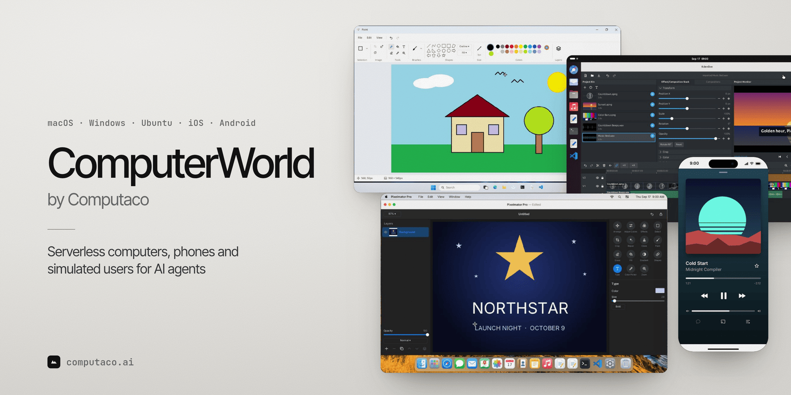

<a href="https://computaco.ai">
  <picture>
    <source media="(prefers-color-scheme: dark)" srcset="assets/cover-dark.png">
    
  </picture>
</a>

<p align="center">
  <strong>Give your agents real desktops and phones to work on — macOS, Windows, Ubuntu, iOS and Android — over one API.</strong>
</p>

<p align="center">
  <a href="https://computaco.ai"></a>
  <a href="https://github.com/ComputaCo/computerworld"></a>
</p>

## ComputerWorld has moved

ComputerWorld — simulated computers, phones and an internet that run in one process, replay to the byte, and turn expert work into verified training data for computer-use agents — is now a product of **COMPUTACO INC.** The engine's source is private, and ComputerWorld is offered as a hosted service at **[computaco.ai](https://computaco.ai)**: spin up a world over HTTP, drive its machines from your agent, fork it, and verify the result.

<h3 align="center">
  <a href="https://computaco.ai/console/create-account.html?ref=FIRST100">Get an API key&nbsp;→</a>
</h3>

<a href="https://computaco.ai/console/create-account.html?ref=FIRST100">
  
</a>

## Install the clients

The Python and JavaScript clients are MIT-licensed and live at [ComputaCo/computerworld](https://github.com/ComputaCo/computerworld).

```sh
pip install "computerworld-cloud @ git+https://github.com/ComputaCo/computerworld.git#subdirectory=python"
npm install github:ComputaCo/computerworld
```

## Quickstart

Set `COMPUTERWORLD_API_KEY`, then boot a desktop at `https://computaco.ai/v1`, open its editor and save a screenshot:

```python
from computerworld_cloud import Client

client = Client()  # reads COMPUTERWORLD_API_KEY
with client.create_world("agent-desktop", seed=1) as world:
    env = world.environment()
    env.click(interaction="shell:launch:editor")
    env.render().save("screen.png")
```

## Links

- **Docs** — <https://computaco.ai/docs/>
- **Pricing** — <https://computaco.ai/pricing/>
- **SDKs** — [ComputaCo/computerworld](https://github.com/ComputaCo/computerworld) ([Python](https://github.com/ComputaCo/computerworld/tree/main/python), [JavaScript](https://github.com/ComputaCo/computerworld))
- **Sign up** — <https://computaco.ai/console/create-account.html?ref=FIRST100>

## The open releases

The releases already published — `computerworld` up to **0.3.0** on [PyPI](https://pypi.org/project/computerworld/) and [npm](https://www.npmjs.com/package/computerworld) — remain available under the [MIT License](LICENSE).

## Thank you

To everyone who starred, used, filed issues against and wrote about the open repository: thank you. ComputerWorld got here because of you.
